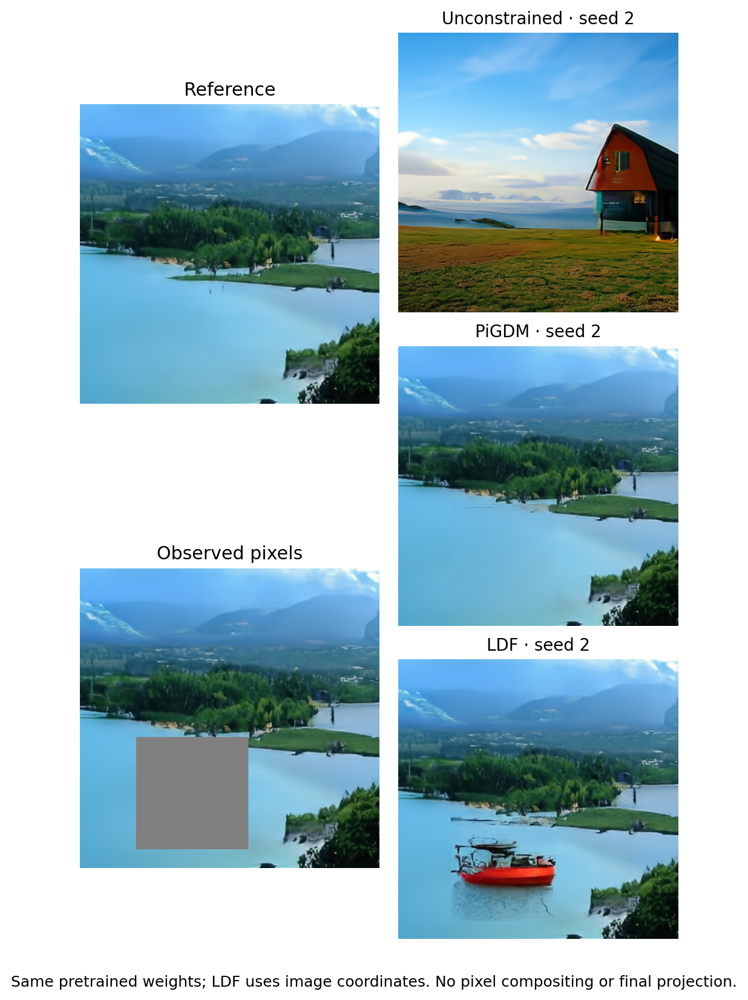
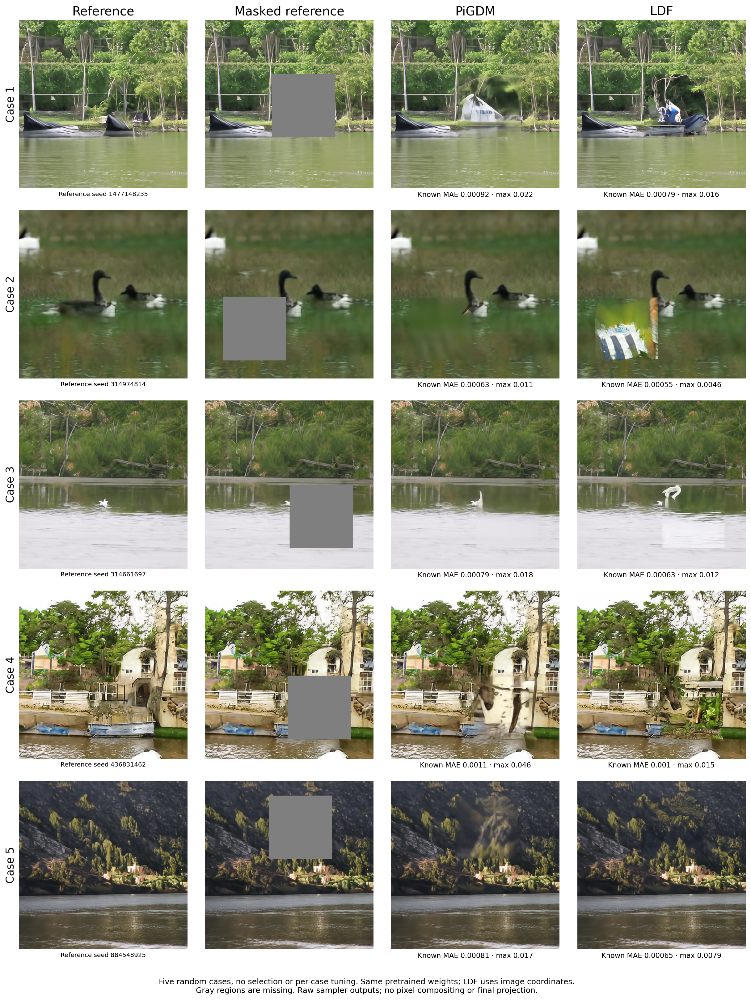

# Constrained Flow Matching via Lagrangian Dual Flows

Code for [Constrained Flow Matching via Lagrangian Dual
Flows](https://arxiv.org/abs/2607.04513) by Vince Kurtz and Alexander Davydov.

**Lagrangian Dual Flows (LDF)** take a pre-trained [flow
matching](https://arxiv.org/abs/2210.02747) model
```math
\dot{x} = v_\theta(x, t)
```
and enforce inference-time constraints
```math
g(x) = 0
```
by augmenting the denoising ODE with Lagrangian dual dynamics
```math
\begin{aligned}
& \dot{x} = v_\theta(x, t) - \nabla g(x)^\top\lambda - \nabla g(x)^\top g(x), \\
& \dot{\lambda} = g(x) / (1-t)^2.
\end{aligned}
```

Inequality constraints are also supported; see the paper for details.

> [!WARNING]
> This is research code. Expect rough edges and breaking changes.

## Install and Testing

```
uv sync --dev
uv sync --group render   # optional: MuJoCo, for the locomotion figures
uv run pytest
uv run ruff check
```

## Layout

```
cfm/            library
  core/         solvers, constraints, utilities
  methods/      LDF, baselines, and the method registry
  models/       flow architectures
  datasets/     training datasets
  cli.py        command line entry point
  sweep.py      benchmark sweeps
problems/       example problems and the problem registry
experiments/    sweep configs and the recorded performance baseline
plots.py        paper figures
```

Methods are registered in `cfm/methods/__init__.py` and problems in
`problems/__init__.py`. `uv run -m cfm.cli list` shows both.

## Methods

| Name | Description | Constraints |
|------|-------------|-------------|
| `ldf` | Lagrangian Dual Flows (ours) | equality, inequality |
| `penalty` | Quadratic penalty on constraint violation | equality, inequality |
| `pcfm` | [Physics-constrained flow matching](https://arxiv.org/abs/2506.04171) | equality |
| `pigdm` | [Pseudoinverse guidance](https://arxiv.org/abs/2310.04432) | equality |
| `cbf` | [SafeFlow](https://arxiv.org/abs/2504.08661) control barrier function filter | inequality |

## Examples

### 2-D toy problems

```bash
uv run -m cfm.cli train --problem star
uv run -m cfm.cli generate --problem star                  # unconstrained
uv run -m cfm.cli generate --problem star --method ldf
uv run -m cfm.cli generate --problem star --method ldf --constraint right_half
```

`bimodal`, `spiral`, `star`, and `unit_circle` each train in about a minute on a
small GPU. Default gains are set per problem and can be overridden on the
command line (`--penalty-weight`, `--rescale-factor`, `--dt`, ...).

### Obstacle avoidance

A flow model is trained on obstacle-free start-to-goal paths, parameterized as
cubic Bezier splines. At inference time, obstacle avoidance is imposed as
inequality constraints on a randomly generated scene.

```bash
uv run -m cfm.cli train --problem obstacles
uv run -m cfm.cli generate --problem obstacles --method ldf --dt 0.002 \
    --num-obstacles 3 --scene-seed 7
uv run -m cfm.cli generate --problem obstacles --method cbf --qp elastic
```

### D4RL locomotion

Walker2D and Hopper examples from
[SafeFlowMatcher](https://arxiv.org/abs/2509.24243). A temporal U-Net is
trained on 32-step windows of D4RL medium-expert data, and a torso height limit
$z_t + \phi v_{z,t} \le h_r$ is imposed at inference time. `h_r` and `phi`
follow [SafeDiffuser](https://arxiv.org/abs/2306.00148).

```bash
uv run -m cfm.cli train --problem walker2d
uv run -m cfm.cli generate --problem walker2d --method ldf
uv run -m cfm.cli generate --problem hopper --method ldf --height-limit 1.5
```

The first run downloads the D4RL data (~770 MB) into `data/d4rl/` from the
`imone/D4RL` HuggingFace mirror.

### MNIST

Inpainting: the top half of each image is fixed and the model fills in the
bottom half. Training requires a GPU.

```bash
uv run -m cfm.cli train --problem mnist
uv run -m cfm.cli generate --problem mnist --method ldf
```

Trained models are saved to `data/<problem>_model.pkl` (override with
`--save-path`).

### Pretrained ImageNet inpainting

`imagenet` uses the 956-million-parameter [JiT-H/32](https://github.com/LTH14/JiT)
EMA1 checkpoint to generate 512 × 512 RGB images (ImageNet class 975,
lakeside). No training or ImageNet dataset download is needed. PyTorch reads
the checkpoint; inference and input derivatives run in JAX on the GPU.

The demonstration uses **seed 2** and an independent reference generated
with seed 123. The default mask removes a 192 × 192 interior square
(rows 288–479, columns 96–287), about 14% of the image. All RGB pixels are
sampled, including the observed region. Reference pixels are never pasted
into the output, and LDF uses zero final projection iterations.

```bash
# Tested on a 32 GB RTX 5090. These settings leave room for CUDA kernels.
export XLA_PYTHON_CLIENT_PREALLOCATE=false
export XLA_PYTHON_CLIENT_MEM_FRACTION=.90
uv run -m experiments.prepare_imagenet --download

# Existing problem/method API and CLI.
uv run -m cfm.cli generate --problem imagenet --seed 2 \
    --no-plot --output-dir results/image_unconstrained
uv run -m cfm.cli generate --problem imagenet --method pigdm --seed 2 \
    --no-plot --output-dir results/image_pigdm
uv run -m cfm.cli generate --problem imagenet --method ldf --seed 2 \
    --no-plot --output-dir results/image_ldf
```

Preparation verifies the upstream SHA256 and converts EMA1 weights. Allow
about 15.3 GB for the downloaded and converted checkpoints. Stored weights
stay on the CPU to avoid duplicating the compiled GPU constants. Generate
one image at a time; the comparison script does this for each seed. The CLI
keeps only a final image snapshot for this example to reduce memory usage.
Raw floating-point outputs are saved before clipping for PNG display.

`--mask center`, `--mask lower-half`, and `--mask lower-left` select other
masks. `--reference image.png` and `--mask-path mask.png` select custom
inputs. Custom masks must be 512 × 512: white means observed, black means
missing. References are center-cropped and resized to 512px. The tuned
settings are specific to the demonstrated reference and interior mask.

The constraint is `x[observed] - reference[observed] = 0` in physical RGB.
LDF keeps one multiplier per observed RGB value. PiGDM uses a zero residual
norm to avoid a 675,840-row dense Jacobian. With pixel selection and the
scalar RGB normalizer, this gives exactly the same PiGDM correction as the
full vector of equalities, including regularization. Tests compare both
representations. LDF does **not** use the norm reduction.

JiT predicts clean pixels. The base adapter preserves the authors' noise
scale of 2, uses class guidance 1, and converts predictions to velocity with
a positive denominator floor of 0.005 (upstream uses 0.05). It also uses the
exact coordinate/time change `s=1-t+a*t`, `tau=a*t/s`, `y=s*z(tau)` with
`a=0.5`; the RGB normalizer compensates for the data scale. This preserves
the physical unconstrained flow and its clean-image estimate.

**LDF additionally uses image coordinates; PiGDM uses the base adapter.**
Directly constraining noisy backbone coordinates produced severe artifacts.
The reference-independent wrapper in `cfm/models/image_coordinates.py`
rotates two standard Gaussian images into an image coordinate `x` and an
auxiliary noise coordinate `e`. With `alpha=0.02`, `b=sqrt(1-alpha²)`, and
`h=alpha+(1-alpha)*t`, the backbone sees `z=h*x+b*(1-t)*e`. Its velocity is
transformed by the chain rule so that `dz/dt=v(z,t)` and `de/dt=0`.
The native initial Gaussian and image endpoint are preserved. Fixed RGB
constraints act on `x`; their gradients leave `e` unchanged. The wrapper
receives neither the reference nor the mask. It is applied through
`PROBLEM.model_for("ldf", model, normalizer)` before calling the unchanged
LDF sampler. This transformation does not preserve PiGDM's clean-estimate
formula, so PiGDM retains its original coordinates. No core algorithms change.

Reproduce the figure in stages, inspecting each before continuing. The
extra unconstrained stage checks the LDF wrapper separately:

```bash
uv run -m experiments.imagenet_inpainting --stage unconstrained
uv run -m experiments.imagenet_inpainting --stage unconstrained-ldf
uv run -m experiments.imagenet_inpainting --stage pigdm
uv run -m experiments.imagenet_inpainting --stage ldf
uv run -m experiments.imagenet_inpainting --stage figure
```

The figure is written to `plots/figures/imagenet_inpainting.png`, with a
JSON record of settings, checkpoint/reference/mask hashes, model coordinates,
runtime, unclipped range, and fixed-pixel errors. Figure assembly rejects
mismatched inputs. The defaults use PiGDM guidance 0.6 and `dt=0.0005`;
LDF uses penalty weight 17, dual factor `1/289`, exponent 2, and `dt=0.00125`.
Finite ODE integration leaves small pixel residuals; there is no compositing
to hide them. The unconstrained and LDF APIs save their last sample at
`1-dt`; PiGDM saves at 1.

**Scope:** this is a selected single-case demonstration, not a robustness
benchmark. Seed 1 produced an obvious LDF artifact with the same settings,
despite small fixed-pixel errors. Larger corner masks and stronger PiGDM
guidance also produced visible seams or flat patches. Inspect new seeds,
references, and masks rather than treating a low residual as a quality test.



Raw fixed-pixel errors for this case (RGB units):

| Sampler | Mean absolute error | Maximum absolute error |
| --- | ---: | ---: |
| PiGDM | 0.000697 | 0.014640 |
| LDF | 0.000588 | 0.008022 |

For five **unselected random references and masks**, use the same GPU
settings above and run:

```bash
uv run -m experiments.imagenet_inpainting_gallery --stage references
uv run -m experiments.imagenet_inpainting_gallery --stage pigdm
uv run -m experiments.imagenet_inpainting_gallery --stage ldf
uv run -m experiments.imagenet_inpainting_gallery --stage figure
```

The experiment seed defaults to `20261107`. The script records all five
reference seeds, independent sampling seeds, and random 192 × 192 interior
mask positions in `results/imagenet_gallery/plan.json` before sampling.
Each reference is a new unconstrained sample from the pretrained model.
Both methods use the same sampling seed within each case and the committed
settings above, with no per-case tuning or removal of poor outputs. Raw
samples, binary masks, masked inputs, hashes, and pixel-error measurements
are saved for every case. The saved 8-bit reference PNGs supply the fixed
pixel targets; constrained outputs are kept as raw floating-point arrays.
A compiled sampler is reused by passing the
reference and observed pixel indices as inputs; the equality constraints
and core samplers are unchanged.

The four-column comparison is saved to
`plots/figures/imagenet_inpainting_five.png`, with its complete experiment
record in the adjacent JSON file. This gallery checks generalization beyond
the selected example; low fixed-pixel errors do not guarantee a good fill.
The recorded five-case run contains visible fill artifacts in both methods.



Offline tests require no pretrained checkpoint, network, or GPU:

```bash
uv run pytest tests/test_jit_image.py tests/test_image_coordinates.py \
    tests/test_image_inpainting.py
```

The small JiT fixture contains outputs and input gradients from the original
PyTorch implementation, with nonzero attention gates. Regeneration is
documented in `tests/make_jit_image_golden.py`; attribution is in `NOTICE`
and `licenses/JiT-MIT.txt`.

## Benchmarks

```bash
# time a single method
uv run -m cfm.cli benchmark --problem star --method ldf --num-samples 20

# time all methods and all examples
uv run -m cfm.cli sweep experiments/table1.toml
uv run -m cfm.cli table --format markdown   # or latex
```

Each sweep case writes a JSON file to `results/`. Completed cases are skipped
unless `--force` is passed. `--check-baseline` fails if any case regressed
relative to `experiments/baseline.json`. See `experiments/table1.toml` for the
config format.

## Paper reproduction

```bash
for p in star mnist obstacles walker2d hopper; do
    uv run -m cfm.cli train --problem $p
done
uv run python plots.py --plot all --regenerate   # figures -> plots/figures
uv run -m cfm.cli sweep experiments/table1.toml
uv run -m cfm.cli table
```

## Contributing

- **New method:** add a module under `cfm/methods/` exposing
  `generate(model, normalizer, constraint, **cfg) -> Samples`, and register it
  in `cfm/methods/__init__.py`.
- **New problem:** add a `Problem` under `problems/` and register it in
  `problems/__init__.py`.
- **Golden tests:** `tests/goldens/*.npy` pin each method's output on a tiny
  fixed model. If a change is intended, regenerate with
  `uv run python -m tests.make_goldens`.
